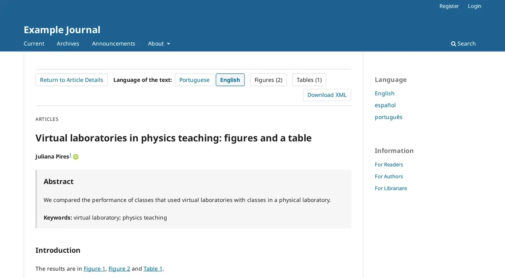
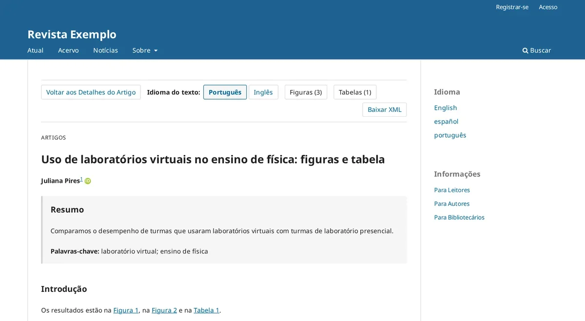
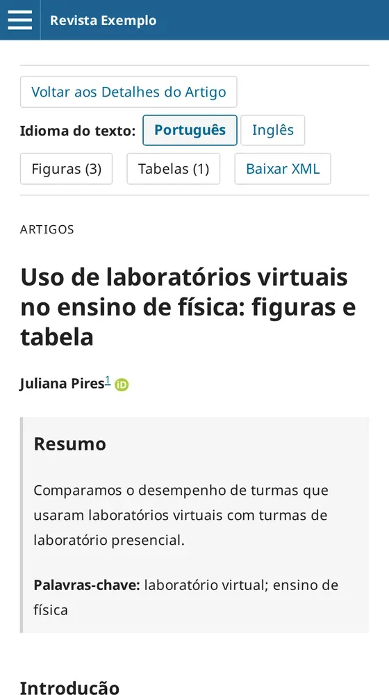

# OJSBR JATS Viewer — OJS plugin

**⬇️ Install package:** [OJS 3.5](https://github.com/OJSBR/ojsbrJatsViewer/releases/download/5.0.0.0/ojsbrJatsViewer-5.0.0.0.tar.gz) — or browse all [Releases](../../releases).

A generic plugin for **Open Journal Systems (OJS) 3.5** that shows **JATS XML galleys** as a page
of the journal, built on the server, with a **language selector** for articles whose XML carries
translations.

> **Developed and maintained by [OJSBR](https://ojsbr.com),** following the path opened by the
> [Lens Galley](https://github.com/asmecher/lensGalley) plugin of the Public Knowledge Project and by
> [eLife Lens](https://github.com/elifesciences/lens). See the [Credits & authorship](#credits--authorship) section below.

## Highlights

- 🌐 **Multilingual JATS XML.** One XML with the article and its translations
  (`<sub-article article-type="translation" xml:lang="…">`, the SciELO SPS model) becomes one page
  with a selector: Português | English | Español… Each language has its own address
  (`?lang=en`), linked with `hreflang` for search engines.
- 🗣️ **Multilingual interface.** The plugin speaks 38 languages, and the labels of the text
  (Abstract, Keywords, References…) follow the language of the text shown, not only the language
  of the site.
- 📐 **Fluid layout, inside the journal.** The article is rendered **in the page of the journal
  theme** (header, menu, sidebar and footer of the journal), with the theme's fonts and colours. It
  does not open a full-screen viewer that looks like a site outside OJS, and it never breaks the
  layout of the journal: wide tables scroll inside their own frame, images fit the column, and the
  page works from a desktop to a 375 px phone.

**🔎 See it live:** [a trilingual article of the Revista Jurídica da Amazônia](https://revista.mpro.mp.br/amazonia/pt_BR/article/view/106/196?lang=pt)
(Português, English and Español from the same XML; switch the language at the top of the text).

## Compatibility & branches

| Application | Branch | Plugin release |
|-------------|--------|----------------|
| OJS 3.5.x   | [`stable-3_5_0`](../../tree/stable-3_5_0) *(default)* | 5.0.0.0 |

Requires PHP 8.2 or later with the `dom`, `xsl` and `intl` extensions. OMP and OPS are not
supported: there the plugin does nothing.

## The problem

OJS shows XML galleys with the Lens Galley plugin, built on eLife Lens (JavaScript in the browser,
unmaintained since 2022). It shows **only the main article** of the XML: the translations
embedded in it are never shown, so a journal that pays for the XML in each language shows only
one. Its page replaces the journal page, the text is built in the browser (search engines see an
empty page), and tables appear under a tab called *Figures*.

## What the plugin does

 

A fictitious article on the OJS test installation of OJSBR.

- **Language selector** for the main article and each translation. The first language shown is
  the language of the interface, when the XML has it; otherwise the language of the main article.
  A translation without its own references shows those of the main article.
- **Figures and Tables panels**, each shown only when the text has items of that kind: an article
  with tables and no figure has a Tables panel, and no empty Figures panel.
- Title, authors with affiliations and ORCID, abstracts (also structured ones, and those in other
  languages) and keywords, sections, lists, quotes, notes, **MathML formulas** (drawn by the
  browser, no external script), tables, figures with captions, references with links to the DOI,
  history, license and DOI of the article, and the biographies of the authors.
- Images are taken from the **dependent files of the galley**, as with the Lens (`fig1.jpg`, or
  just `fig1`, in the XML).
- The **full text is in the HTML** of the page, readable by search engines.
- A file that is not well-formed XML, or not a JATS article, shows a message with a link to
  download it.
- The download of the galley still returns the original XML file.

### Works with the Lens Galley plugin

The plugin answers the same hook as the Lens (`ArticleHandler::view::galley`), just before it.
While it is enabled, XML galleys of articles open with this viewer; disable it and the Lens is used
again, with nothing to undo. Issue galleys are left to the Lens.

### Statistics

With the Lens, the reader's browser downloaded the XML, and that download was counted. Here the
reader no longer downloads it, so each view of the page is counted as the core counts the download
of the galley file (same `assoc_type` as the core's reports).

### Security

The XML comes from third parties:

- it is parsed without network access, without loading the DTD and without replacing external
  entities (XXE);
- the stylesheet runs with all file and network access forbidden and without PHP functions;
- every XML element is mapped to a known HTML element, attributes are chosen one by one, and
  links only keep `http(s)`, `mailto` and `ftp` addresses (no `javascript:` or `data:`).

### Cache

The HTML of every language of a galley is kept in `cache/ojsbrJatsViewer/<galley id>/`. A new
galley file, a changed image or a new version of the plugin makes a new entry, and the old one is
removed.

## Installation

1. Download the package for your OJS from [Releases](../../releases).
2. In OJS: **Settings › Website › Plugins › Upload a New Plugin**, and upload the `.tar.gz`.
3. Enable **Multilingual JATS Viewer** in the list of generic plugins.

## How it works (technical)

- `classes/JatsDocument.php`: reads the XML safely, lists its languages and points the images to
  the files of the galley.
- `xsl/jats2html.xsl`: turns one language of the article into HTML (written for this plugin; the
  HTML generator of SciELO packtools was evaluated, but it builds a whole SciELO page with Bootstrap
  and jQuery, which does not fit in a journal theme).
- `classes/JatsRenderer.php`: runs the stylesheet with every access forbidden.
- `classes/JatsCache.php`: keeps the HTML of each galley.
- `templates/display.tpl`: the page, inside the journal theme.

## Tests

PHPUnit (`tests/`, on `PKPTestCase`) and Cypress (`cypress/tests/functional/`), run by PKP's
continuous integration on OJS with PHP 8.2/8.3 and MySQL/PostgreSQL:

- reading: languages of the main article and translations, files refused (not well-formed, not
  JATS), an external entity that tries to read a file of the server, images matched to the files of
  the galley, languages matched with or without region;
- rendering: each language with its own text, references of a translation, the tables panel of an
  article without figures, figures and missing images, MathML, DOIs and ORCID, nothing dangerous
  let through (`javascript:`, `data:`, `<script>`, event attributes), the stylesheet unable to read a
  file;
- the cache and the 38 locale files;
- in the browser, on articles imported with the native import of OJS: the language selector, the
  tables panel, the images, a file that is not JATS, the XXE file, and the plugin turned off.

## Credits & authorship

- **Developed and maintained by** [OJSBR](https://ojsbr.com).
- Distributed under the **GNU GPL v3**.

This plugin stands on the work of others, and we thank them:

- **[Lens Galley](https://github.com/asmecher/lensGalley)**, by the [Public Knowledge Project](https://pkp.sfu.ca)
  (Simon Fraser University, GPL v3), brought XML galleys to the readers of OJS. This plugin follows its
  approach: the same hook for the galley page, the same way of finding the images among the dependent
  files of the galley and the same addresses for them, and the original XML kept for download.
- **[eLife Lens](https://github.com/elifesciences/lens)**, by [eLife](https://elifesciences.org) and
  [Substance](https://github.com/substance), the reader on which the Lens Galley is built, showed how a JATS
  article can be read online, with its figures and tables at hand in panels beside the text.
- **[SciELO packtools](https://github.com/scieloorg/packtools)**, by [SciELO](https://scielo.org)
  (BSD), whose HTML generator for SciELO PS was studied for the multilingual model (`sub-article`
  translations) that this plugin shows.

## AI use

Generative AI (Claude, by Anthropic) was used to write and run tests, improve the code and bring
it in line with PKP standards. Every change is reviewed and tested by OJSBR, which is responsible
for the published releases.

## Contributing

Issues and pull requests are welcome. See [`CONTRIBUTING.md`](CONTRIBUTING.md).

## License

Distributed under the **GNU GPL v3**. See [`LICENSE`](LICENSE) and `docs/COPYING`.

---

## 🇧🇷 Português

**⬇️ Pacote de instalação:** [OJS 3.5](https://github.com/OJSBR/ojsbrJatsViewer/releases/download/5.0.0.0/ojsbrJatsViewer-5.0.0.0.tar.gz) — ou veja todas as [Releases](../../releases).

Plugin genérico para o **Open Journal Systems (OJS) 3.5** que exibe as **composições em XML
JATS** como uma página da revista, gerada no servidor, com **seletor de idioma** para os artigos
cujo XML traz traduções.

> **Desenvolvido e mantido pela [OJSBR](https://ojsbr.com),** seguindo o caminho aberto pelo plugin
> [Lens Galley](https://github.com/asmecher/lensGalley), do Public Knowledge Project, e pelo
> [eLife Lens](https://github.com/elifesciences/lens). Veja a seção [Créditos e autoria](#créditos-e-autoria).

### Destaques

- 🌐 **XML JATS multilíngue.** Um XML com o artigo e suas traduções
  (`<sub-article article-type="translation" xml:lang="…">`, o modelo SciELO SPS) vira uma página
  com seletor: Português | English | Español… Cada idioma tem endereço próprio (`?lang=en`),
  indicado aos buscadores com `hreflang`.
- 🗣️ **Interface multilíngue.** O plugin fala 38 idiomas, e os rótulos do texto (Resumo,
  Palavras-chave, Referências…) acompanham o idioma do texto exibido, não só o idioma do site.
- 📐 **Layout fluido, dentro da revista.** O artigo aparece **na página do tema da revista**
  (cabeçalho, menu, barra lateral e rodapé da revista), com as fontes e cores do tema. Não abre um
  visualizador de tela cheia com cara de site fora do OJS e nunca quebra o layout da revista:
  tabela larga rola dentro do próprio quadro, imagem se ajusta à coluna, e a página funciona do
  computador ao celular de 375 px.

**🔎 Veja funcionando:** [um artigo trilíngue da Revista Jurídica da Amazônia](https://revista.mpro.mp.br/amazonia/pt_BR/article/view/106/196?lang=pt)
(Português, English e Español do mesmo XML; troque o idioma no topo do texto).

### Compatibilidade e branches

| Aplicação | Branch | Versão do plugin |
|-----------|--------|------------------|
| OJS 3.5.x | [`stable-3_5_0`](../../tree/stable-3_5_0) *(padrão)* | 5.0.0.0 |

Requer PHP 8.2 ou superior, com as extensões `dom`, `xsl` e `intl`. OMP e OPS não são
suportados: neles o plugin não faz nada.

### O problema

O OJS exibe as composições XML com o plugin Lens Galley, baseado no eLife Lens (JavaScript no
navegador, sem manutenção desde 2022). Ele mostra **só o artigo principal** do XML: as traduções
embutidas nunca aparecem, e a revista que paga pelo XML em cada idioma exibe só um. A página dele
substitui a página da revista, o texto é montado no navegador (o buscador vê uma página vazia), e
as tabelas ficam numa aba chamada *Figures*.

### O que o plugin faz

 

Artigo fictício, na instalação de teste do OJS da OJSBR.

- **Seletor de idioma** para o artigo principal e cada tradução. O idioma inicial é o da
  interface, quando o XML o tem; senão, o do artigo principal. Tradução sem referências próprias
  mostra as do artigo principal.
- **Painéis de Figuras e de Tabelas**, cada um só aparece se houver itens desse tipo: artigo só
  com tabelas tem painel de Tabelas, e nenhum painel de Figuras vazio.
- Título, autores com afiliações e ORCID, resumos (inclusive estruturados e em outros idiomas) e
  palavras-chave, seções, listas, citações, notas, **fórmulas em MathML** (o navegador desenha, sem
  script externo), tabelas, figuras com legenda, referências com link para o DOI, histórico,
  licença e DOI do artigo, e a biografia dos autores.
- As imagens vêm dos **arquivos dependentes da composição**, como no Lens (`fig1.jpg`, ou só
  `fig1`, no XML).
- O **texto completo fica no HTML** da página, legível pelos buscadores.
- Arquivo que não é XML bem formado, ou não é artigo JATS, mostra uma mensagem com link para
  baixá-lo.
- O download da composição continua devolvendo o arquivo XML original.

#### Convive com o Lens Galley

O plugin responde ao mesmo gancho do Lens (`ArticleHandler::view::galley`), logo antes dele.
Enquanto estiver habilitado, as composições XML dos artigos abrem neste visualizador;
desabilitado, volta o Lens, sem nada a desfazer. As composições de edição continuam com o Lens.

#### Estatísticas

Com o Lens, o navegador do leitor baixava o XML, e esse download era contado. Aqui o leitor não
baixa mais, por isso cada visualização da página é contada como o núcleo conta o download do
arquivo da composição (mesmo `assoc_type` dos relatórios do núcleo).

#### Segurança

O XML vem de terceiros:

- é lido sem acesso à rede, sem carregar a DTD e sem substituir entidades externas (XXE);
- a folha de estilo roda com todo acesso a arquivo e rede proibido e sem funções PHP;
- cada elemento do XML vira um elemento HTML conhecido, os atributos são escolhidos um a um e os
  links só mantêm endereços `http(s)`, `mailto` e `ftp` (nada de `javascript:` nem `data:`).

#### Cache

O HTML de todos os idiomas de uma composição fica em `cache/ojsbrJatsViewer/<id da composição>/`.
Arquivo novo na composição, imagem trocada ou versão nova do plugin geram uma entrada nova, e a
antiga é apagada.

### Instalação

1. Baixe o pacote do seu OJS em [Releases](../../releases).
2. No OJS: **Configurações › Site › Plugins › Enviar novo plugin**, e envie o `.tar.gz`.
3. Habilite **Visualizador JATS multilíngue** na lista de plugins genéricos.

### Testes

PHPUnit (`tests/`) e Cypress (`cypress/tests/functional/`), rodados pela integração contínua da
PKP no OJS com PHP 8.2/8.3 e MySQL/PostgreSQL: leitura segura do XML (inclusive XXE), cada idioma
com o próprio texto, painel de tabelas sem figuras, imagens, nada perigoso passa, cache, os 38
arquivos de idioma e, no navegador, artigos importados pela importação nativa do OJS.

### Idiomas

Interface do plugin em 38 idiomas; português do Brasil, inglês e espanhol revisados, os demais
marcados como *fuzzy*.

### Créditos e autoria

- **Desenvolvido e mantido pela** [OJSBR](https://ojsbr.com).
- Distribuído sob a **GNU GPL v3**.

Este plugin se apoia no trabalho de outros, e agradecemos a eles:

- **[Lens Galley](https://github.com/asmecher/lensGalley)**, do [Public Knowledge Project](https://pkp.sfu.ca)
  (Simon Fraser University, GPL v3), levou as composições XML aos leitores do OJS. Este plugin segue a
  abordagem dele: o mesmo gancho da página da composição, a mesma forma de achar as imagens entre os
  arquivos dependentes e os mesmos endereços para elas, e o XML original mantido para download.
- **[eLife Lens](https://github.com/elifesciences/lens)**, da [eLife](https://elifesciences.org) e da
  [Substance](https://github.com/substance), o leitor sobre o qual o Lens Galley foi construído, mostrou como
  ler um artigo JATS na web, com figuras e tabelas à mão em painéis ao lado do texto.
- **[SciELO packtools](https://github.com/scieloorg/packtools)**, da [SciELO](https://scielo.org)
  (BSD), cujo gerador de HTML para o SciELO PS foi estudado para o modelo multilíngue (traduções em
  `sub-article`) que este plugin exibe.

### Uso de IA

Foi usada IA generativa (Claude, da Anthropic) para escrever e rodar testes, melhorar o código e
alinhá-lo aos padrões da PKP. Toda mudança é revisada e testada pela OJSBR, que responde pelas
releases publicadas.

### Licença

Distribuído sob a **GNU GPL v3**. Veja [`LICENSE`](LICENSE) e `docs/COPYING`.
